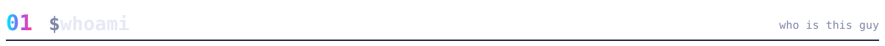
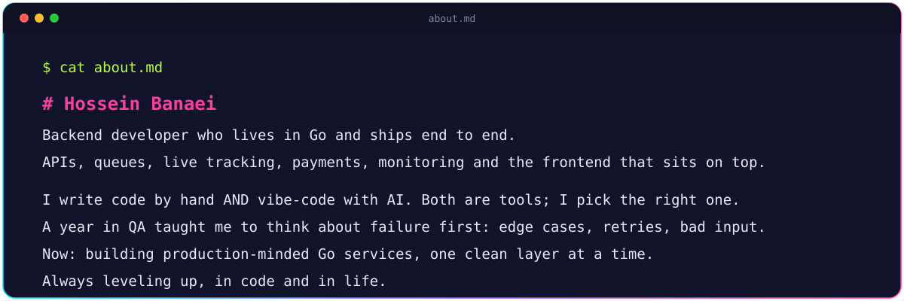
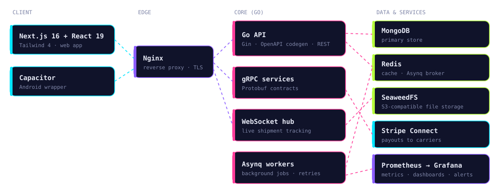
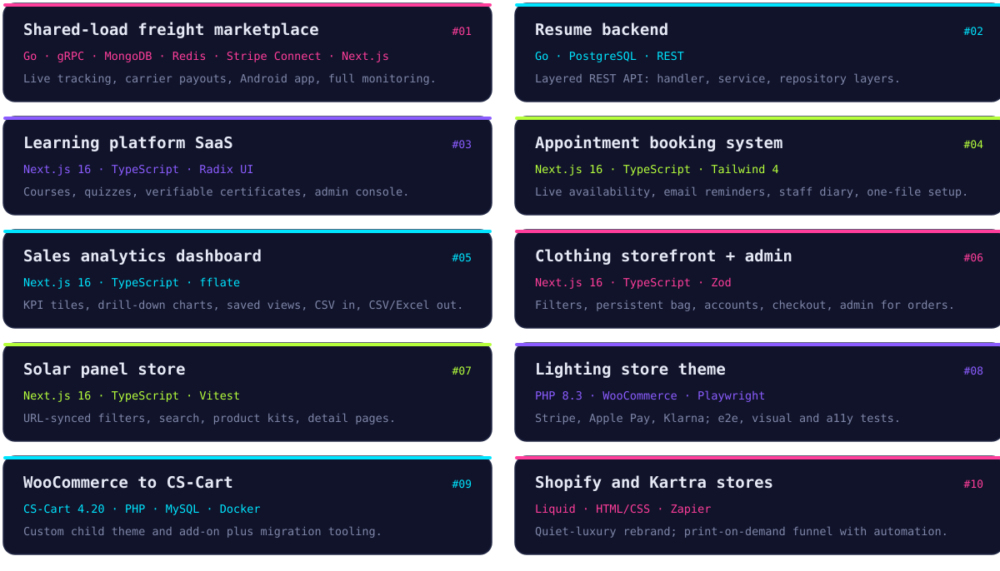
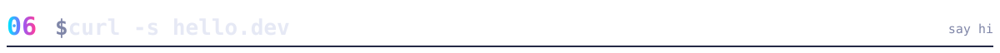
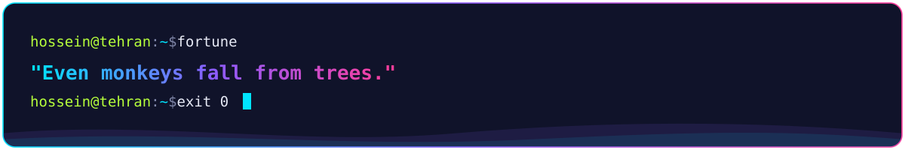

 

 

 

Most of these are client or private work, so the repos aren't public. Happy to walk through any of them.

<table><tr>
<td width="50%" align="center"></td>
<td width="50%" align="center"></td>
</tr></table>

<picture>
  <source media="(prefers-color-scheme: dark)" srcset="https://raw.githubusercontent.com/hosseinbanaei/hosseinbanaei/output/github-snake-dark.svg" />
  <source media="(prefers-color-scheme: light)" srcset="https://raw.githubusercontent.com/hosseinbanaei/hosseinbanaei/output/github-snake.svg" />
  
</picture>

**Building something with Go, or hiring for a backend role? Say hi.**

 

